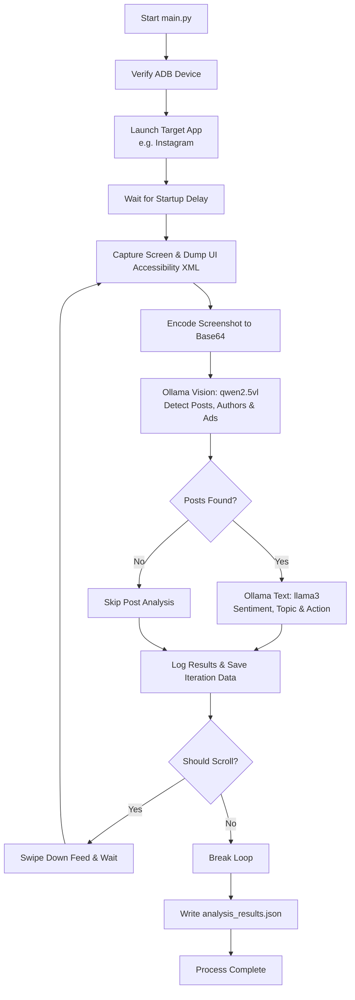

# 📱 Local AI Android Social Media Feed Automator

A modular, production-ready Python automation agent that interacts with an Android device via **ADB (Android Debug Bridge)** to read, visually analyze, and interact with social media feeds (e.g., Instagram, Facebook) using **Local AI (Ollama)** with zero cloud dependencies.

---

## 🏗️ Architecture & Workflow



1. **Screen & UI Ingestion**: Captures high-resolution screen buffers (`adb exec-out screencap -p`) and extracts the accessibility node hierarchy (`adb exec-out uiautomator dump /dev/tty`).
2. **Local Vision Inference**: Uses `qwen2.5vl` running via local Ollama to parse screenshot content combined with accessibility strings, ignoring sponsored posts, ads, and system navigation chrome.
3. **Local Text Intelligence**: Uses `llama3` (or `qwen2.5`) to evaluate sentiment, categorize topics, and recommend operational actions (e.g., Save, Ignore, Copy).
4. **Adaptive Device Control**: Executes gestures (scroll, tap, clipboard broadcast) based on the LLM's structured JSON decisions.
5. **Data Persistence**: Stores structured findings into a local `analysis_results.json` log.

---

## 📦 Project Structure

```text
AUTOMATOR/
├── config.py             # Global constants, endpoints, timeouts, and logging configuration
├── adb_controller.py     # AndroidController class: ADB wrapper for screen, UI dump, swipe, taps
├── ai_agent.py           # AIAgent class: Ollama API client for vision & text models (strict JSON)
├── main.py               # CLI orchestration pipeline executing the feed analysis loop
├── app.py                # Web Control Dashboard server (Flask + SSE streaming + REST API)
├── templates/
│   └── index.html        # Interactive dark-mode dashboard (Tailwind CSS, Lucide icons)
├── requirements.txt      # Python dependencies (requests, flask)
└── README.md             # Complete documentation and setup guide
```

---

## 📋 Prerequisites

### 1. Android Debug Bridge (ADB)
- Download the official [Android SDK Platform-Tools](https://developer.android.com/tools/releases/platform-tools).
- Extract the archive and add the platform-tools directory to your system `PATH`.
- Verify installation in your terminal:
  ```bash
  adb version
  ```

### 2. Android Device Setup
1. Open **Settings > About Phone** and tap **Build Number** 7 times to enable **Developer Options**.
2. Go to **Settings > System / Additional Settings > Developer Options**:
   - Enable **USB Debugging**.
   - **Crucial for Xiaomi / HyperOS / MIUI / ColorOS / Realme devices**: Enable **USB Debugging (Security Settings)**. This is required to permit touch simulation (`adb shell input swipe` / `tap`).
   - Enable **Stay Awake** (keeps the screen on while charging) to avoid the device locking during automation.
3. Connect your device via USB. When the dialog appears on your phone screen ("*Allow USB debugging?*"), check **Always allow from this computer** and tap **Allow**.
4. Confirm connection:
   ```bash
   adb devices
   ```
   Output should display your device with status `device`:
   ```text
   List of devices attached
   e3a9b12c    device
   ```

### 3. Local AI with Ollama
- Install [Ollama](https://ollama.com/).
- Verify Ollama is running (`http://localhost:11434`).
- Pull the required vision and text models:
  ```bash
  ollama pull qwen2.5vl
  ollama pull llama3
  ```
  *(Alternative models such as `qwen2.5` or `llama3.2-vision` can be configured in `config.py`)*.

### 4. Optional: Clipper App (for enhanced clipboard integration)
For seamless clipboard operations via ADB broadcast, you can install the [Clipper APK](https://github.com/majido/clipper) on your device:
```bash
adb install clipper.apk
```
If Clipper is not installed, the controller automatically falls back to `adb shell input text`.

---

## 🚀 Installation & Setup

1. Clone or navigate to the project directory:
   ```bash
   cd c:\Users\usuario1\Documents\granjita\AUTOMATOR
   ```

2. (Optional but recommended) Create and activate a virtual environment:
   ```bash
   python -m venv venv
   # On Windows PowerShell:
   .\venv\Scripts\Activate.ps1
   # On Windows CMD:
   .\venv\Scripts\activate.bat
   ```

3. Install dependencies:
   ```bash
   pip install -r requirements.txt
   ```

---

## ⚙️ Configuration (`config.py`)

You can customize parameters directly in `config.py`:

| Parameter | Default Value | Description |
|---|---|---|
| `PACKAGE_NAME` | `"com.instagram.android"` | Target app package (use `"com.facebook.katana"` for Facebook) |
| `OLLAMA_BASE_URL` | `"http://localhost:11434/api/generate"` | Ollama API generate endpoint |
| `VISION_MODEL` | `"qwen2.5vl"` | Local multimodal vision model |
| `TEXT_MODEL` | `"llama3"` | Local language model for post analysis |
| `MAX_ITERATIONS` | `5` | Maximum number of scroll/analyze iterations |
| `OUTPUT_FILE` | `"analysis_results.json"` | JSON output file for collected results |
| `SCROLL_WAIT_SECONDS` | `2.5` | Sleep delay after scrolling for content to load |

---

## ▶️ Running the Automator

You can interact with the automator in two ways: via the **Web Control Dashboard** (recommended) or directly via the **CLI Script**.

### Option A: Web Control Dashboard (GUI)
Start the web dashboard server:
```bash
python app.py
```
*(or `py app.py` on Windows)*

Then open your browser at **`http://localhost:5000`**. From the dashboard you can:
- View the **live phone screen** with auto-refresh.
- Manually trigger **Swipe Up**, **Swipe Down**, and **Capture Screen**.
- Select the target app (**Instagram**, **Facebook**, **Threads**, or custom package).
- Adjust iteration count and scroll wait intervals.
- Click **Start Automation** to run the local AI pipeline in the background.
- Watch **real-time streaming logs** and **live post analysis cards** (author, topic, sentiment, suggested action).
- View and export `analysis_results.json` directly from the UI.

---

### Option B: Command-Line Interface (CLI)
Ensure your phone is unlocked and connected, and Ollama is active. Then execute:

```bash
python main.py
```
*(On Windows systems where `python` defaults to Python Launcher, use `py main.py`)*

### Console Output Example:
```text
2026-09-10 16:15:00 [INFO] AndroidAutomator: Checking for connected ADB devices...
2026-09-10 16:15:00 [INFO] AndroidAutomator: Connected Android device(s) verified: e3a9b12c
2026-09-10 16:15:00 [INFO] AndroidAutomator: Launching target app: com.instagram.android
2026-09-10 16:15:05 [INFO] AndroidAutomator: ==============================
2026-09-10 16:15:05 [INFO] AndroidAutomator: --- Iteration 1 / 5 ---
2026-09-10 16:15:05 [INFO] AndroidAutomator: ==============================
2026-09-10 16:15:05 [INFO] AndroidAutomator: Capturing screen to 'screen.png'...
2026-09-10 16:15:06 [INFO] AndroidAutomator: Extracting UI accessibility tree from device...
2026-09-10 16:15:07 [INFO] AndroidAutomator: Querying vision model 'qwen2-vl' via Ollama...
2026-09-10 16:15:15 [INFO] AndroidAutomator: Querying text model 'llama3' for post analysis...
2026-09-10 16:15:17 [INFO] AndroidAutomator: AI Vision Reasoning : Identified two public organic posts; skipped sponsored ad banner.
2026-09-10 16:15:17 [INFO] AndroidAutomator: AI Should Scroll     : True
2026-09-10 16:15:17 [INFO] AndroidAutomator: Posts Detected       : 2
2026-09-10 16:15:17 [INFO] AndroidAutomator:   [Post #1] Author: @techinsider | IsAd: False
    - Snippet   : "New advancements in local AI inference on edge hardware..."
    - Topic     : Technology
    - Sentiment : Positive
    - Action    : Save
2026-09-10 16:15:17 [INFO] AndroidAutomator: Scrolling down. Waiting 2.5s for feed reload...
...
2026-09-10 16:15:45 [INFO] AndroidAutomator: Successfully saved 5 iteration record(s) to 'analysis_results.json'.
2026-09-10 16:15:45 [INFO] AndroidAutomator: Social media feed automation process completed successfully.
```

---

## 📊 Sample Output Format (`analysis_results.json`)

```json
[
  {
    "iteration": 1,
    "timestamp": "2026-09-10T22:15:17Z",
    "vision_data": {
      "posts": [
        {
          "author": "techinsider",
          "content_snippet": "New advancements in local AI inference on edge hardware...",
          "is_ad": false
        }
      ],
      "should_scroll": true,
      "reasoning": "Identified organic content from techinsider."
    },
    "text_analysis": {
      "analysis": [
        {
          "author": "techinsider",
          "topic": "Artificial Intelligence",
          "sentiment": "Positive",
          "action": "Save"
        }
      ]
    }
  }
]
```

---

## 🔧 Troubleshooting

| Issue | Cause | Resolution |
|---|---|---|
| `RuntimeError: No connected and authorized Android device found.` | Device disconnected, unauthorized, or ADB service inactive. | Replug USB cable, run `adb devices`, and confirm the RSA authorization prompt on the device screen. |
| `adb: command not found` | ADB platform-tools directory not in environment PATH. | Add your Android SDK `platform-tools` folder path to the Windows Environment Variables `Path`. |
| Screen capture is black | App uses `FLAG_SECURE` (e.g. banking apps, Instagram disappearing photos/DMs). | Ensure the app is resting on the public home feed, which is not protected by `FLAG_SECURE`. |
| Swipes do not trigger scroll | Missing touch permissions on Xiaomi/MIUI/HyperOS. | Enable **USB Debugging (Security Settings)** under Developer Options (requires SIM card / Xiaomi account login). |
| Device locks / screen turns off | Screen sleep timeout reached. | Enable **Stay Awake while charging** in Developer Options, or increase screen timeout to 10+ minutes. |
| `ConnectionRefusedError` on Ollama | Ollama service is not running or listening on port 11434. | Start Ollama (`ollama serve`) and test `http://localhost:11434` in your browser. |
| Vision model returns invalid JSON | Model hallucination or markdown formatting. | The agent automatically strips markdown fences and enforces Ollama's native `"format": "json"` parameter. |
